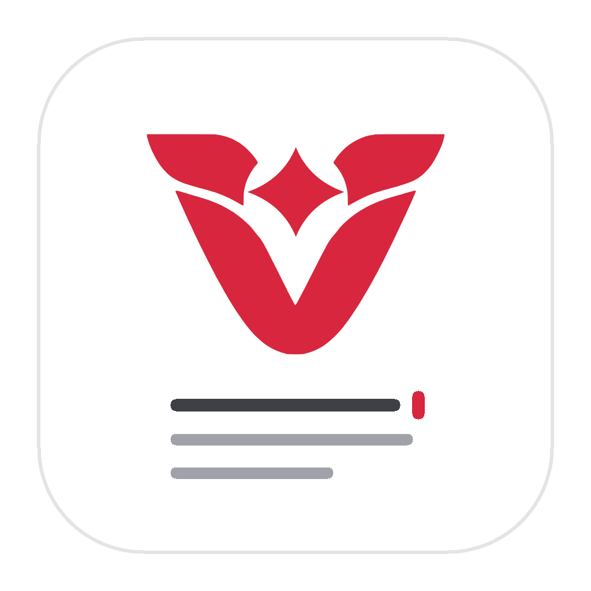
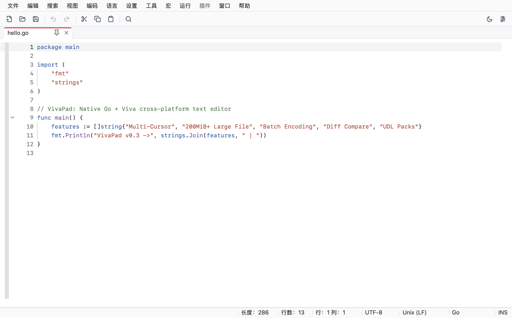
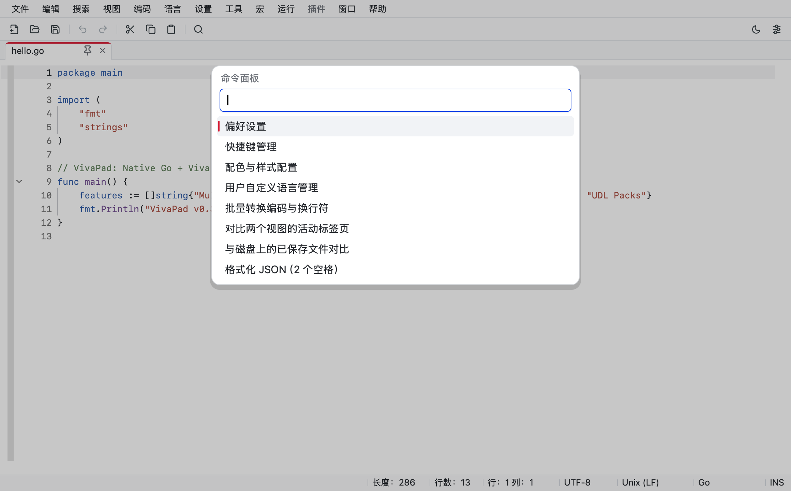
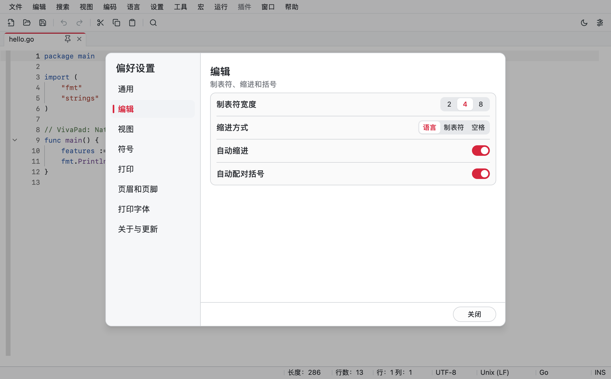

<div align="center">



# VivaPad

**A fast, native, cross-platform Notepad++ alternative built with Go & Viva.**

English | [简体中文](README.zh-CN.md)

[](LICENSE)
[](https://go.dev/)
[](#build--package)
[](#highlights)

</div>

---

VivaPad is a lightweight, local-first desktop text & code editor crafted in **Go 1.26** and **[Viva](https://github.com/vivaui/viva)**. No Electron, no WebView, no telemetry — just instant startup, low memory footprint, and the everyday engineering power of Notepad++ across **macOS, Windows, and Linux**.

## Screenshots

<p align="center">
  
</p>

<details open>
<summary><b>Command Palette & Modern Preferences</b></summary>
<p align="center">
  
  
</p>
</details>

## Highlights

| Category | Capabilities |
| :--- | :--- |
| **Blazing Large-File Engine** | Paged, bounded-memory viewer for 200 MiB+ logs and sparse files (>1 GiB) with sub-millisecond first-frame open, streaming regex/text search, Windows `FILE_SHARE_READ\|WRITE\|DELETE` live-tail compatibility, and Windows `\\?\` long paths. |
| **Multi-Cursor & Column Editing** | `Primary+Shift+D` select next occurrence, `Primary+Shift+L` select all, `Primary+Shift+J` skip, `Alt+Click` add/remove carets, `Alt+Drag` rectangular column selection, per-line multi-cursor paste, and single-step atomic Undo/Redo. |
| **Developer & Diff Tools** | Built-in JSON / XML format & minify, Base64 / URL / Hex / Hash (MD5, SHA-1/256/512) & timestamp converters, and side-by-side **Compare / Diff** view (active split tabs or against disk). |
| **Encoding & Batch Conversion** | Full UTF-8 / UTF-8 BOM / UTF-16 LE·BE / GB18030 / Windows-1252 & LF/CRLF/CR support, plus **Batch Convert** (`Encoding → Batch Convert…`) with mandatory Dry-run preview and atomic write-back across open tabs or directories. |
| **Themes, Style & UDL Packs** | Classic Light, Modern Dark, Monokai, and Follow System themes; **Style Configurator** for per-token colors; **User Defined Languages (UDL)** with 8 built-in packs (`Nginx`, `Dockerfile`, `Log`, `GraphQL`, `Prisma`, `Protobuf`, `Makefile`, `Env`) and versioned JSON import/export. |
| **Modern Navigation & Productivity** | Global **Command Palette** (`Primary+Shift+P`), **Quick File/Tab Switcher** (`Primary+P`), searchable **Shortcut Mapper**, Project Panels, Folder as Workspace, Function List, Document Map, Macros, Split View, and external file change notifications. |
| **Signed Delta Auto-Updates** | Built-in Ed25519-verified incremental bsdiff auto-updates (`viva/update`) with multi-base release patches, automatic full-package fallback, and dirty-tab quit protection. |

## Keyboard Shortcuts

> `Primary` is `⌘` (Command) on macOS and `Ctrl` on Windows / Linux. Every shortcut can be customized in **Settings → Shortcut Mapper…**.

| Action | Shortcut |
| :--- | :--- |
| Command Palette | `Primary + Shift + P` |
| Quick Switch Tab / File | `Primary + P` |
| Preferences | `Primary + ,` |
| Find / Replace / Find in Files | `Primary + F` / `Primary + H` / `Primary + Shift + F` |
| Multi-select Next / All / Skip | `Primary + Shift + D` / `Primary + Shift + L` / `Primary + Shift + J` |
| Add / Remove Caret | `Alt + Click` |
| Exit Multi-Cursor | `Esc` |
| Switch Tab 1–9 | `Primary + 1..9` |

## Installation & First Launch (Unsigned Builds)

Pre-built binaries are currently **unsigned** (no Apple Developer notarization or Windows Authenticode certificate yet):

- **macOS**: After dragging `VivaPad.app` into `/Applications`, if macOS reports *"VivaPad is damaged"* or *"cannot be verified"*, remove the quarantine attribute with one command and launch:
  ```sh
  xattr -dr com.apple.quarantine /Applications/VivaPad.app
  open /Applications/VivaPad.app
  ```
- **Windows**: If SmartScreen displays a warning, click **More info** → **Run anyway** (or unzip and run the portable `.zip` package).
- **Linux**: Install the `.deb` package with:
  ```sh
  sudo apt install ./vivapad_*.deb
  ```

## Build & Package

Requires **Go 1.26+** and the platform prerequisites documented by Viva.

```sh
# Run from source
go run ./cmd/vivapad
go run ./cmd/vivapad path/to/file.txt

# Run tests
go test ./... -count=1

# Package macOS .app (unsigned local build)
go tool viva package --no-sign
```

Cross-platform CI builds native artifacts for **macOS** (`.app` / `.zip`), **Windows** (`.exe` NSIS installer & portable `.zip`), and **Linux** (`.deb` / `.tar.gz`).

## License

VivaPad is licensed under the **[Apache License 2.0](LICENSE)**.

Third-party libraries and assets remain subject to their respective open-source licenses (including [Viva](https://github.com/vivaui/viva) and Go standard/extended libraries declared in `go.mod`).
