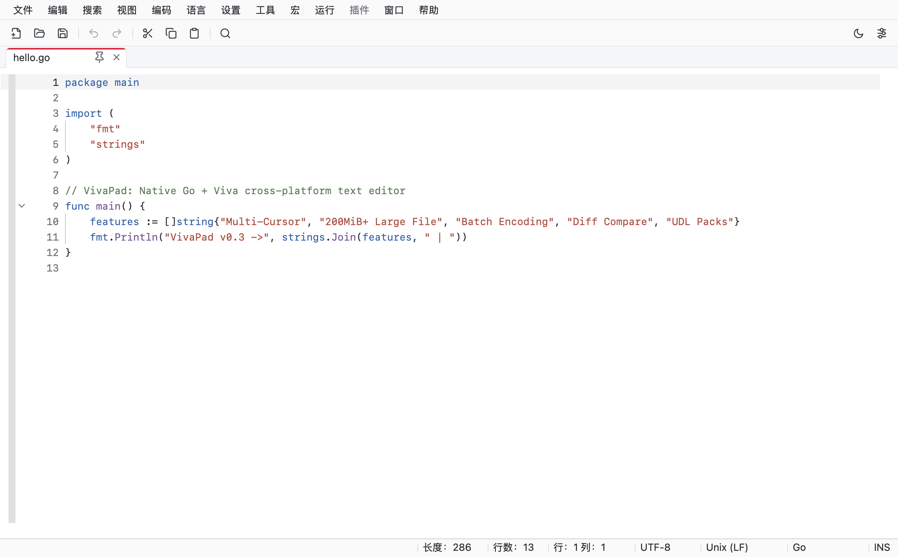
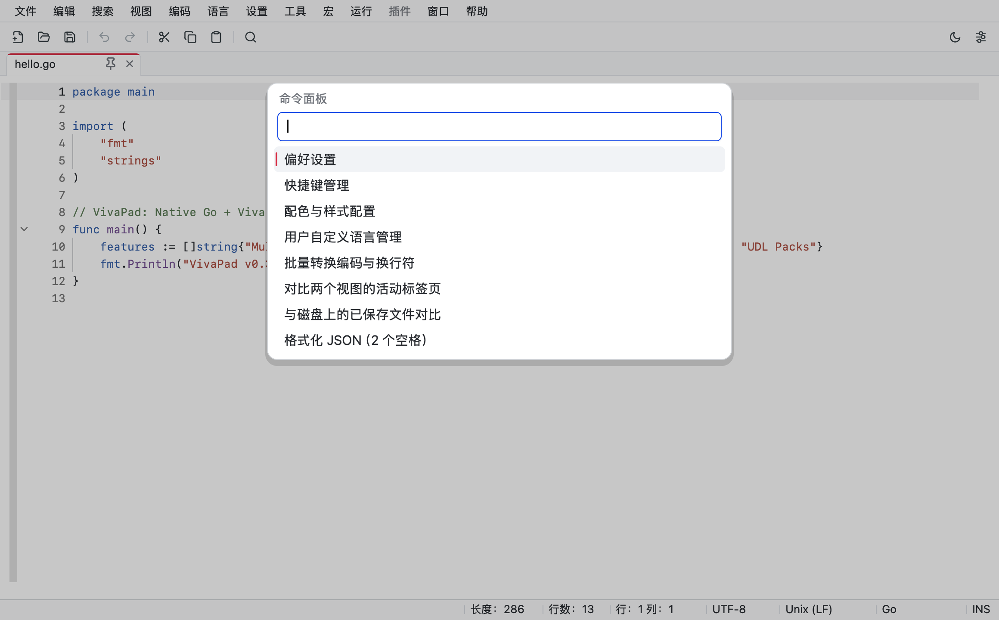
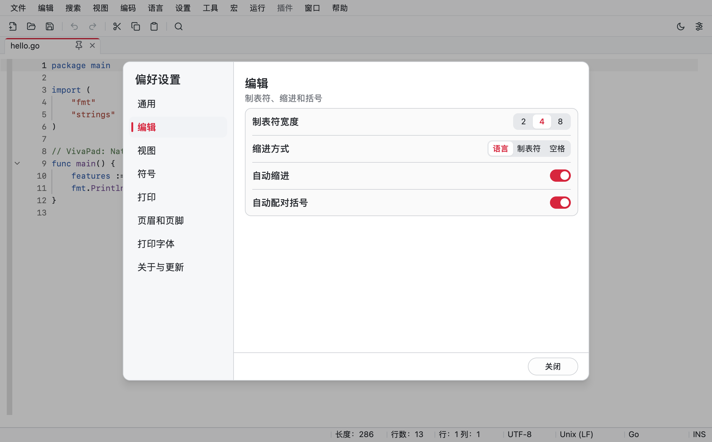

<div align="center">


# VivaPad

**基于 Go 与 Viva 打造的极速、原生、跨平台 Notepad++ 现代替代品。**

[English](README.md) | 简体中文

[](LICENSE)
[](https://go.dev/)
[](#构建与打包)
[](#核心亮点)

</div>

---

VivaPad 是一款采用 **Go 1.26** 与 **[Viva](https://github.com/vivaui/viva)** 原生编写的本地优先桌面文本与代码编辑器。不依赖 Electron 或 WebView、无遥测、冷启动极快、内存占用极低，在 **macOS、Windows 和 Linux** 上提供媲美并超越经典 Notepad++ 的高频工程编辑体验。

## 界面预览

<p align="center">
  
</p>

<details open>
<summary><b>全局命令面板 & 现代偏好设置页</b></summary>
<p align="center">
  
  
</p>
</details>

## 核心亮点

| 模块 | 能力介绍 |
| :--- | :--- |
| **超大文件分页引擎** | 200 MiB+ 日志与 >1 GiB 稀疏文件毫秒级首帧打开、有界低内存流式正则搜索；支持 Windows `FILE_SHARE_READ\|WRITE\|DELETE` 实时日志跟踪与 `\\?\` 长路径。 |
| **多光标与列块编辑** | 支持 `Primary+Shift+D` 逐个选中同词、`Primary+Shift+L` 全选同词、`Primary+Shift+J` 跳过、`Alt+点击` 增删副光标、`Alt+拖动` 列块选择、按行分发粘贴及单步原子撤销/重做。 |
| **开发者工具与文件对比** | 内置 JSON / XML 格式化与压缩、Base64 / URL / Hex / 哈希（MD5、SHA-1/256/512）与时间戳转换，以及左右分栏 **Compare / Diff**（支持对比双视图或对比磁盘原文）。 |
| **多编码与批量转换** | 完整支持 UTF-8 / UTF-8 BOM / UTF-16 LE·BE / GB18030 / Windows-1252 与 LF/CRLF/CR；内置 **批量转换（编码 → 批量转换…）**，强制先 Dry-run 预览再原子写回，自动跳过二进制与符号链接。 |
| **多主题、配色定制与 UDL** | 内置经典浅色、现代深色、Monokai 与跟随系统主题；支持 **配色与样式配置器**；内置 8 套开箱即用 **用户自定义语言（UDL）**（`Nginx`、`Dockerfile`、`Log`、`GraphQL`、`Prisma`、`Protobuf`、`Makefile`、`Env`）与 v1 JSON 导入/导出。 |
| **现代导航与工作流** | 全局双语 **命令面板（`Primary+Shift+P`）**、**快速切文件/标签（`Primary+P`）**、可搜索的 **快捷键管理**、项目面板、文件夹工作区、函数列表、文档缩略图、宏录制、分屏与外部文件变动提醒。 |
| **多基线签名增量升级** | 基于 `viva/update` 实现 Ed25519 验签与 bsdiff 多基线增量补丁自动更新，自动回退全量包，升级重启前安全保护未保存标签页。 |

## 常用快捷键

> `Primary` 在 macOS 为 `⌘`（Command），在 Windows / Linux 为 `Ctrl`。所有快捷键均可在 **设置 → 快捷键管理…** 中自由修改。

| 功能 | 快捷键 |
| :--- | :--- |
| 全局命令面板 | `Primary + Shift + P` |
| 快速切换标签 / 文件 | `Primary + P` |
| 偏好设置 | `Primary + ,` |
| 查找 / 替换 / 目录中查找 | `Primary + F` / `Primary + H` / `Primary + Shift + F` |
| 选中下一个 / 全选 / 跳过同词 | `Primary + Shift + D` / `Primary + Shift + L` / `Primary + Shift + J` |
| 添加 / 移除独立光标 | `Alt + 点击` |
| 退出多光标模式 | `Esc` |
| 快速切换第 1–9 个标签页 | `Primary + 1..9` |

## 安装与首次打开（未签名版本）

当前预编译安装包暂未购买 Apple 公证或 Windows 代码签名证书，首次打开如遇系统拦截可按以下方式放行：

- **macOS**：将 `VivaPad.app` 拖入「应用程序（`/Applications`）」后，如提示“已损坏，无法打开”或“无法验证开发者”，在终端执行以下快捷命令移除隔离属性即可正常打开：
  ```sh
  xattr -dr com.apple.quarantine /Applications/VivaPad.app
  open /Applications/VivaPad.app
  ```
- **Windows**：若 SmartScreen 弹出保护提示，点击 **更多信息** → **仍要运行**（也可直接解压使用便携版 `.zip`）。
- **Linux**：使用以下命令安装 `.deb` 包：
  ```sh
  sudo apt install ./vivapad_*.deb
  ```

## 构建与打包

需要 **Go 1.26+** 及 Viva 所需的平台基础环境。

```sh
# 从源码运行
go run ./cmd/vivapad
go run ./cmd/vivapad path/to/file.txt

# 运行测试
go test ./... -count=1

# 打包 macOS 本地应用（未签名）
go tool viva package --no-sign
```

GitHub Actions 流水线原生构建三端安装包：**macOS**（`.app` / `.zip`）、**Windows**（NSIS `.exe` 安装程序与便携 `.zip`）与 **Linux**（`.deb` / `.tar.gz`）。

## 开源协议

VivaPad 采用 **[Apache License 2.0](LICENSE)** 开源协议。

所依赖的第三方开源库与资源（包括 [Viva](https://github.com/vivaui/viva) 及 `go.mod` 中声明的 Go 生态依赖）均遵循其各自的开源许可协议。
